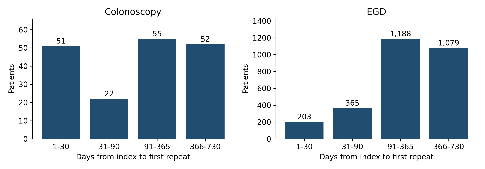

# Repeat endoscopy patterns and ascertainment in electronic health record extracts

Final scientific deliverables for Dr Eric Shah | October 24 2026

This project establishes recorded repeat-endoscopy patterns in the available data, quantifies how source linkage and cohort definitions change those patterns, and evaluates exploratory associations. The analytic work is complete for the supplied extracts. The strongest conclusions concern documented utilization and ascertainment; these data cannot establish the population incidence of repeat endoscopy or identify unnecessary care.

## Principal findings

| Finding | Final result and meaning |
| --- | --- |
| Recorded repeat colonoscopy | 180/12,462 (1.44%; 95% CI 1.25-1.67%) after a diagnostic or biopsy index procedure. |
| Recorded repeat EGD | 2,835/38,864 (7.29%; 95% CI 7.04-7.56%) after a diagnostic or biopsy index procedure. |
| Additional source coverage | Linking the second procedure workbook recovered 24 additional colonoscopy and 18 additional EGD repeat patients in the fixed calendar-opportunity cohorts. |
| Bleeding-defined component | 65 qualifying patients; zero observed later 45378 procedures in the original colonoscopy source. Only five patients had positive appointment-based follow-up. Zero observed events does not establish zero clinical risk. |
| Clinical interpretation | Repeated testing and overlapping symptom codes are measurable. Appropriateness, new-provider effects and same-indication repeat ordering are not identifiable from these extracts. |

The analysis population is selected by historical source queries. The colonoscopy and EGD cohorts can contain the same individuals and should not be added together as a unique-person total. Two years of calendar opportunity is not proof of continuous follow-up. All findings are observational and exploratory; no causal claim is made.

## What is delivered

The package includes this report, an editable manuscript and printable manuscript, prepared patient-level datasets, exact model inputs, aggregate tables, high-resolution figures, a field dictionary, source checksums, reproducible code and validation records. Source identifiers and exact dates are isolated in the restricted folder. The package remains internal research data and is not a public-use data release.

## Research questions and design

Design: retrospective analysis of linked, routinely collected electronic health record and professional-fee extracts spanning January 1, 2000 through May 31, 2023. The analysis uses a fixed existing sample; no prospective sample-size target or post hoc power calculation is claimed. The final statistical specification was completed with knowledge of these data and is not represented as preregistered.

| Component | Population and endpoint |
| --- | --- |
| Broad colonoscopy | Earliest observed CPT 45378 or 45380 patient-day in the colonoscopy workbook. Outcome: first later patient-day with either core code in either procedure workbook. |
| Broad EGD | Earliest observed CPT 43235 or 43239 patient-day in the EGD workbook. Outcome: first later patient-day with either core code in either procedure workbook. |
| Bleeding-defined colonoscopy | Earliest 45378 encounter with same-patient, same-encounter K62.5. Outcome: later-day 45378 for any reason through day 730. |
| Clinical symptom component | At the first core index, any abdominal pain, constipation or rectal bleeding for colonoscopy; any abdominal pain, heartburn or dysphagia for EGD. A repeat may be for any indication. |
| Shared symptom component | The first repeat has at least one target diagnosis-code group shared with the index. This is coded overlap, not adjudicated persistence of the same indication. |

The broad recorded-event estimand is the proportion with a documented first repeat on days 1-730 among index patients with at least 730 calendar days before the cutoff. This restriction standardizes calendar opportunity only. Separate all-index-patient counts retain people with shorter calendar opportunity. Primary descriptive results retain the original source-specific index and broaden only the follow-up search, permitting a matched assessment of source ascertainment.

The restricted bleeding analysis answers a different question from the broad cohorts. It is retained in full and is not expanded to manufacture outcome events. First observed qualifying procedure does not mean first lifetime procedure. Same-day records are consolidated; repeated billing lines and multiple diagnosis rows are not repeat procedures.

## Scope of clinical claims

A billed procedure does not establish a completed high-quality examination, a normal examination, an unnecessary examination or a new order. Surveillance recommendations depend on findings, examination quality and clinical context [4]. The data lack sufficiently validated findings, pathology, bowel preparation, order linkage and longitudinal provider assignments for appropriateness or provider-change inference.

## How the analysis data were prepared

Original workbooks were read directly rather than treating previous joined CSV files as the analytic source. Files were retained unchanged. The source manifests record SHA-256 checksums, and every transformation is implemented in the supplied code. The source cutoff remains May 31, 2023; the analysis date does not extend follow-up.

| Step | Implementation |
| --- | --- |
| 1 Source selection | Professional-fee procedures, encounter dates and demographics come from the procedure-specific original workbooks. Dedicated coded-diagnosis replacements supply encounter flags; the Clinic workbook supplies appointment timestamps. |
| 2 Complete EGD diagnosis import | Both DiagnosesEverything worksheets were read: 1,000,000 plus 119,247 rows. A single-sheet import would omit 119,247 records. The combined diagnosis data are deduplicated by patient, encounter, code and description. |
| 3 Normalize and link | Dates are parsed and normalized to calendar dates. Codes are trimmed and uppercased where appropriate. Diagnoses join on PatientID AND EncounterID, never on PatientID alone. |
| 4 Aggregate before joining | Presence flags are maximized within encounter. Broad-cohort same-day encounters are then consolidated at patient-day level; the earliest core procedure day defines index. |
| 5 Derive outcomes | Collapse repeat evidence to distinct patient-days, require date strictly after index, select the first repeat and calculate elapsed days. Count events through day 730 inclusively. |
| 6 Preserve ascertainment | Store event, available calendar duration, appointment duration, admission duration and modeled follow-up separately. Missing follow-up is never automatically replaced with 730 days. |
| 7 Export and validate | Export one row per patient per cohort and each exact model input. Use study IDs in analysis files and retain the local source-key crosswalk separately. Reconcile all numerators and denominators to the source derivations. |

No clinical values were imputed. Unknown diagnosis coverage is explicitly flagged. Source AGE is retained only in the bleeding cohort audit, with an unverified reference date, and is never relabeled age at index. Recorded gender is retained using the source meaning. Smoking and medical history unavailable at the exact index are not treated as clinically absent.

The original data dictionary uses 24 months for mood and overlapping pain diagnoses. Those constructs are not inferred from an undocumented alternate lookback. Valid baseline timing and complete observation are unavailable, so those planned predictors are not analyzed. BMI is described at the exact index encounter only. The GI-department flag indicates an available order from a named department, not the identity of the endoscopist or a new referring provider.

## Final descriptive findings

| Cohort | All index patients | Any core repeat | Symptom index then any repeat | Symptom index and shared code at first repeat |
| --- | --- | --- | --- | --- |
| Colonoscopy | 12,776 | 180/12,462 (1.44%; 95% CI 1.25-1.67%) | 64/4,321 (1.48%; 95% CI 1.16-1.89%) | 48/4,321 (1.11%; 95% CI 0.84-1.47%) |
| EGD | 41,772 | 2,835/38,864 (7.29%; 95% CI 7.04-7.56%) | 1,071/19,200 (5.58%; 95% CI 5.26-5.91%) | 629/19,200 (3.28%; 95% CI 3.03-3.54%) |

The last three columns use patients with 730 calendar days available. Symptom columns use their own symptom-positive index denominators. All intervals are Wilson 95% intervals for recorded-event proportions; they do not quantify uncertainty from extraction bias or outside-system missing events.

The second source increases observed colonoscopy repeat ascertainment by 15.4% relative to the original 156 repeat patients (24 additional), versus 0.64% relative to 2,817 EGD repeat patients (18 additional). This is evidence of source fragmentation, not an intervention effect or the sensitivity of either source against a gold standard.

After both EGD diagnosis worksheets are included, unavailable index-diagnosis counts are 96 in colonoscopy and 35 in EGD across all index patients. These are current source-coverage findings; blank coding is not evidence that symptoms were clinically absent.

## Timing and clinical interpretation

| Cohort | Median days to first repeat among events | First repeat on days 31-730 | Any repeat on days 31-730 |
| --- | --- | --- | --- |
| Colonoscopy | 179.5 | 129/12,462 (1.04%; 95% CI 0.87-1.23%) | 132/12,462 (1.06%; 95% CI 0.89-1.25%) |
| EGD | 273.0 | 2,632/38,864 (6.77%; 95% CI 6.53-7.03%) | 2,670/38,864 (6.87%; 95% CI 6.62-7.13%) |

The first-repeat and any-repeat definitions differ because an early repeat can be followed by another later procedure. Excluding early first repeats changes the endpoint; it does not adjudicate the early procedures as inappropriate. A short interval may reflect incomplete preparation, completion of an examination, therapy or evolving symptoms, none of which can be reliably resolved here.

EGD has a higher recorded-repeat proportion than colonoscopy in these selected extracts. These are different clinical populations with different selection and coding mechanisms. A cross-procedure risk ratio would invite an unsupported causal or case-mix interpretation and is not reported.

Shared symptom coding supplies a narrower description of recurrent symptom-associated utilization. It remains an operational measure: incidental diagnoses can coexist with a different principal indication, and coding may persist even when the reason for repeat testing changes. No count in this package is labeled low-value or unnecessary endoscopy.

## Scientific contribution

The findings jointly show that repeat-procedure research is sensitive to both the clinical index definition and where subsequent care is retrieved. Narrow bleeding eligibility can produce a zero-event subset while broader source populations have observable repeats. Source linkage recovers additional events without changing the index cohort, and complete multi-sheet diagnosis import prevents an avoidable loss of clinical characterization.

## Statistical methodology and exploratory associations

Descriptive analyses report counts, proportions, missingness, medians and interquartile ranges. Wilson confidence intervals accompany broad recorded-event proportions. Models are exploratory, with no multiplicity correction and no causal interpretation. The complete coefficient tables, including nonsignificant results, are supplied.

Modified Poisson regression with HC0 robust standard errors models recorded repeat by day 730 among patients with calendar opportunity [3]. Separate models include recorded female versus male gender, index era (2000-2011, 2012-2015, 2016 onward), clinically relevant symptom groups and an unavailable-diagnosis indicator where it varies. The model outputs are adjusted recorded-event probability ratios. They are not hazard ratios or population risk ratios under complete surveillance.

| EGD predictor | Adjusted recorded-event probability ratio |
| --- | --- |
| Female | 0.78 (95% CI 0.72-0.83) |
| Abdominal pain | 0.54 (95% CI 0.49-0.59) |
| Heartburn | 0.40 (95% CI 0.34-0.49) |
| Dysphagia | 1.05 (95% CI 0.96-1.15) |

Symptom and recorded-gender associations may reflect case mix, indication, coding practice, source selection and follow-up capture. Age at index is unavailable; residual confounding is substantial. Constancy and zero-event exposure strata are checked, and the rectal-bleeding term is omitted from broad colonoscopy regression rather than presenting an unstable near-zero coefficient.

Cox models use Efron tie handling and the same nonredundant predictors under three observation assumptions: calendar cutoff/horizon; latest recorded contact (admission, appointment or procedure); and latest appointment supplemented by repeat-procedure evidence. Outcomes are bounded by day 730 and the cutoff. Zero-duration records are excluded only from that model and enumerated. A recorded repeat supplies contact evidence, creating potential outcome-dependent follow-up; the resulting models are sensitivity analyses rather than validated survival estimators.

Rank-transformed Schoenfeld-residual tests assess proportional hazards. Days 1-90 and 91-730 fits examine time-varying patterns; these are exploratory splits. Hazard ratios can change with the observation rule. No single model is selected as definitive because its p values are preferable. Independent statsmodels PHReg fits verify the main lifelines Cox coefficients and standard errors.

All final interval fits converged, with a smaller optimization step used for stable estimation. Constant or zero-event binary strata are checked and any omissions are logged. Robustness analyses excluding index IBD codes and restricting to known index diagnoses are supplied separately. Excluding index IBD leaves colonoscopy unchanged and yields 2,775/38,142 EGD repeat patients (7.28%), close to the overall recorded proportion.

The specified age-forced and forward/backward Cox analysis is non-estimable in the bleeding-defined cohort because there are no events, and age at index is unverified. Variables 2 and 4 are constant by entry criteria. No stepwise model, penalized substitute or fabricated hazard ratio is used for that component. Broad models address a separate exploratory population and do not masquerade as completion of the restricted model.

## Observation sensitivity and the bleeding component

| Cohort and observation rule | Analyzed patients | Events | Excluded for zero or unavailable time |
| --- | --- | --- | --- |
| Colonoscopy / Administrative | 12,776 | 181 | 0 |
| Colonoscopy / Last recorded contact | 3,437 | 181 | 9,339 |
| Colonoscopy / Last appointment plus repeat evidence | 1,402 | 181 | 11,374 |
| EGD / Administrative | 41,767 | 2,952 | 5 |
| EGD / Last recorded contact | 16,944 | 2,952 | 24,828 |
| EGD / Last appointment plus repeat evidence | 9,261 | 2,952 | 32,511 |

The event count is stable across these observation rules, while the amount of available time and the included risk set change markedly. Event capture and non-event observation therefore have different evidentiary strength. The supplied survival estimates are assumption-dependent sensitivity outputs; they are not endorsed as complete-capture two-year incidence.

For EGD, the dysphagia hazard ratio changes from 1.05 (95% CI 0.95-1.15) under calendar follow-up to 1.46 (1.33-1.59) under the latest-contact proxy. The female-gender hazard ratio remains below 1 across all three rules (approximately 0.74-0.77). Five of seven EGD calendar-model terms show proportional-hazards test p values below 0.05. These findings favor reporting model sensitivity and time variation, rather than declaring dysphagia an established independent driver.

Exploratory interval models show a stronger dysphagia association early: calendar-rule HR 1.98 (1.65-2.37) on days 1-90 versus 0.87 (0.78-0.97) on days 91-730. Contact-rule estimates are 2.42 (2.02-2.89) and 1.25 (1.12-1.39), respectively. A single overall HR therefore conceals important time variation; the late association also depends on observation assumptions.

In the bleeding-defined component, index dates span January 25, 2016 to February 6, 2023. There are 65 patients, 36 with female recorded gender, and zero observed later 45378 events in the original source. Searching both procedure workbooks also finds no 45378 repeat within 730 days. Fifty-five patients have two years of calendar opportunity, but only five have any positive appointment duration.

| Follow-up definition | Zero days | Positive days | Capped proxy days |
| --- | --- | --- | --- |
| Billing index to latest appointment | 60 | 5 | 738 |
| Billing index to latest admission | 50 | 15 | 759 |
| Admission index to latest admission | 51 | 14 | 756 |

The appointment distribution is 60 at day 0, two at day 1, two at day 3 and one at day 948. Capping at 730 yields 738 proxy patient-days, not verified person-time. The first-observed-procedure eligibility sensitivity retains 64 patients; adding ICD-9 code 569.3 retains 65; neither produces a repeat event. Admission-based duration changes do not resolve the lack of events.

## Limitations and final conclusions

Selection: source queries contain extensive diagnosis exclusions, including code 569.3 in exclusion blocks. The supplied files cannot determine how the extraction engine executed the mapping or how many eligible source patients were removed. The dedicated colonoscopy diagnosis replacement contains two 569.3 rows, neither linked to an eligible index. Adding this code locally cannot reconstruct excluded encounters.

Outcome ascertainment: follow-up may be filtered by the extraction design; out-of-system care, death, enrollment and complete observation are unavailable. Appointments can be scheduled rather than completed visits. No-reported-repeat is not synonymous with no repeat procedure. Broad confidence intervals account for binomial variation, not these systematic errors.

Clinical classification: billing and diagnosis codes do not establish completed procedure quality, principal indication, ordering intent or appropriateness. K59 includes conditions beyond constipation, R10.1 denotes upper abdominal pain rather than diagnosed functional dyspepsia, and R10.8/R10.9 are other or unspecified abdominal pain codes. These labels are handled as code groups, not asserted clinical diagnoses.

Confounding and transportability: verified age, complete baseline disease history and provider trajectories are unavailable. Recorded gender and symptom associations should be interpreted within the filtered source population. Calendar-era effects may reflect clinical practice, code-system changes or source selection. The clinical cohorts overlap and are analyzed separately.

Final conclusion: the available extracts establish documented repeat endoscopy and shared-symptom coding patterns, with materially greater event ascertainment after cross-source linkage. They also demonstrate that narrow eligibility and incomplete follow-up can yield a misleadingly reassuring zero-event result. These are completed findings from this project; population incidence, appropriateness and provider-change effects remain outside what the data can identify.

## Publication positioning

The accompanying manuscript is positioned as a retrospective descriptive study of recorded utilization and ascertainment, with exploratory associations. It does not require additional clinical investigation to support the stated conclusions. Author identities and contributions, institutional setting details, ethics/IRB determination, funding, conflicts and permission to disclose data must be supplied by the authors before journal submission; none is invented here. These are publication declarations, not uncompleted analytic work.

## References

1. Benchimol EI, Smeeth L, Guttmann A, et al. The REporting of studies Conducted using Observational Routinely-collected health Data (RECORD) statement. PLoS Med. 2015;12:e1001885. https://doi.org/10.1371/journal.pmed.1001885

2. Kotecha D, Asselbergs FW, Achenbach S, et al. CODE-EHR best practice framework for the use of structured electronic healthcare records in clinical research. BMJ. 2022;378:e069048. https://doi.org/10.1136/bmj-2021-069048

3. Zou G. A modified Poisson regression approach to prospective studies with binary data. Am J Epidemiol. 2004;159:702-706. https://doi.org/10.1093/aje/kwh090

4. Gupta S, Lieberman D, Anderson JC, et al. Recommendations for follow-up after colonoscopy and polypectomy: a consensus update by the US Multi-Society Task Force on Colorectal Cancer. Gastrointest Endosc. 2020;91:463-485.e5. https://www.asge.org/home/resources/publications/guidelines/recommendations-for-follow-up-after-colonoscopy-and-polypectomy-a-consensus-update-by-the-us-multi-society-task-force-on-colorectal-cancer

5. STROBE Initiative. Checklist for cohort studies. https://www.strobe-statement.org/fileadmin/Strobe/uploads/checklists/STROBE_checklist_v4_cohort.pdf
