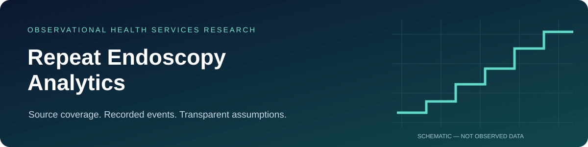
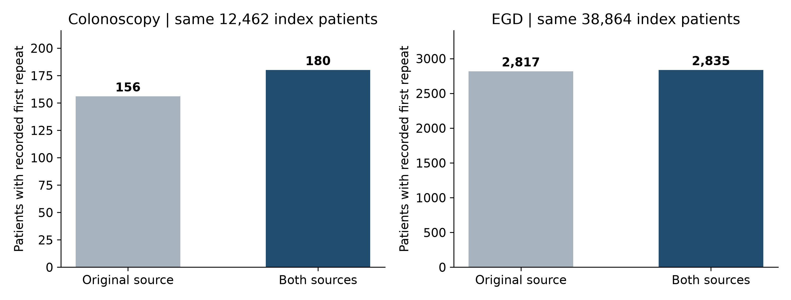
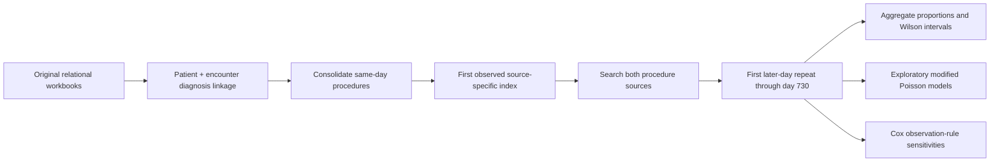

<div align="center">



**Recorded utilization · source ascertainment · observation sensitivity**

[](https://github.com/iamimtiaztonmoy/repeat-endoscopy-analytics/actions/workflows/validate.yml)


[Manuscript](Scientific%20manuscript.md) · [Scientific report](Final%20scientific%20report.pdf) · [Methods](documentation/Dataset%20preparation%20and%20analysis%20specification.md) · [Reproduce](docs/REPRODUCIBILITY.md)

</div>

## Research question

How often is a first repeat colonoscopy or esophagogastroduodenoscopy (EGD) recorded in selected electronic health record extracts, and how do source coverage, coded symptoms, and observation assumptions affect those estimates?

This repository contains the analysis code, aggregate findings, and scientific reports for a retrospective study of records dated **January 1, 2000–May 31, 2023**. Analyses are exploratory and were developed after inspecting the available data. The repository is a research companion, not a clinical decision tool.

## Findings at a glance

| Measure | Colonoscopy | EGD |
| :--- | ---: | ---: |
| Broad index cohort | 12,776 | 41,772 |
| Patients with 730 days of calendar opportunity | 12,462 | 38,864 |
| Recorded first repeats within days 1–730 | 180 | 2,835 |
| Recorded repeat proportion (95% Wilson CI) | 1.44% (1.25–1.67%) | 7.29% (7.04–7.56%) |
| Additional repeat patients found in the second source | 24 | 18 |
| Shared-symptom first repeats / symptom-positive index patients | 48 / 4,321 | 629 / 19,200 |

Source: [repeat estimates](tables/Repeat%20estimates.csv), [broad baseline table](tables/table4_broad_baseline.csv), and [manuscript](Scientific%20manuscript.md). Cohorts can overlap; their sizes must not be added as a unique-person count.

> **Interpretation matters.** Calendar opportunity does not establish continuous observation. These are recorded-utilization proportions, not complete-capture population incidence. Shared symptom codes do not establish an unchanged indication, and repeat procedures do not establish unnecessary care.



## Analytical design



Core codes are **45378/45380** for colonoscopy and **43235/43239** for EGD. Both EGD diagnosis worksheets are included. A separate bleeding-defined colonoscopy component contains 65 patients with zero observed repeats and does not support Cox estimation. Age at index could not be verified; models must not be described as age-adjusted. See the [methods and limitations](docs/METHODS.md).

## Explore the project

| Resource | Contents |
| :--- | :--- |
| [Scientific manuscript](Scientific%20manuscript.md) | Structured abstract, methods, results, discussion, references |
| [Final scientific report](Final%20scientific%20report.md) | Detailed findings and interpretation |
| [Cox analysis](Cox%20proportional%20hazards%20analysis.md) | Hazard ratios, diagnostics, and early/late associations |
| [`tables/`](tables/) | Machine-readable aggregate results, including nonsignificant model terms |
| [`figures/`](figures/) | Publication figures in PNG and editable SVG |
| [`code/`](code/) | Original derivation, modeling, verification, and report scripts |
| [`documentation/`](documentation/) | Data dictionary, source hashes, specifications, original validation evidence |
| [Reproducibility guide](docs/REPRODUCIBILITY.md) | Public checks and restricted-data reconstruction instructions |

The three reports are also available as PDF and editable Word files at the repository root.

## Quick start — no clinical data required

```bash
git clone https://github.com/iamimtiaztonmoy/repeat-endoscopy-analytics.git
cd repeat-endoscopy-analytics
python tools/validate_public.py
```

This standard-library check verifies release checksums, Python syntax, allowed file inventory, CSV headers, and the principal proportions against the supplied aggregate tables. It **does not rerun patient-level models**. GitHub Actions runs the same checks on pushes and pull requests.

## Reproducibility and data access

Patient-level datasets, pseudonymous model matrices, exact encounter dates, linkage keys, raw workbooks, and meeting recordings are intentionally absent. A public clone supports inspection and aggregate verification; full reconstruction requires authorized access to the original workbooks in an approved environment. See [data availability](DATA_AVAILABILITY.md) and [reproduction instructions](docs/REPRODUCIBILITY.md).

The original package records 137 passing validation checks and independent Cox implementation comparisons. These are **archived evidence from the source analysis**, distinct from the repository checks run here. No claim of new clinical validation or peer review is made.

## Citation, contributions, and rights

Use [CITATION.cff](CITATION.cff) to cite this repository and include the commit you used. This is repository metadata, not a journal authorship declaration. See [CONTRIBUTING.md](CONTRIBUTING.md) for methodological changes and [CHANGELOG.md](CHANGELOG.md) for release notes.

No open-source or reuse license is granted at this stage; applicable rights remain with their respective holders. Author affiliations, ethics approval, funding, and disclosure statements must be supplied by the investigators before journal submission. See [rights and publication status](RIGHTS.md).
